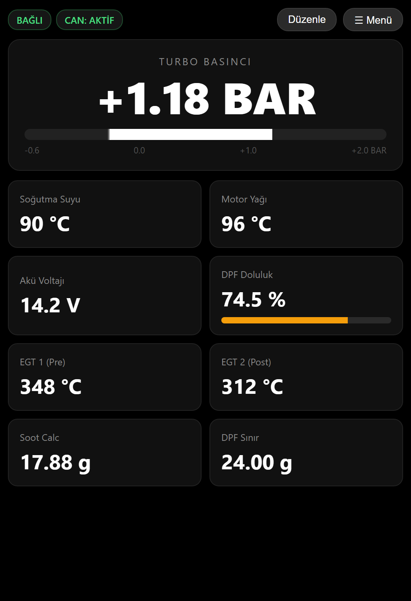
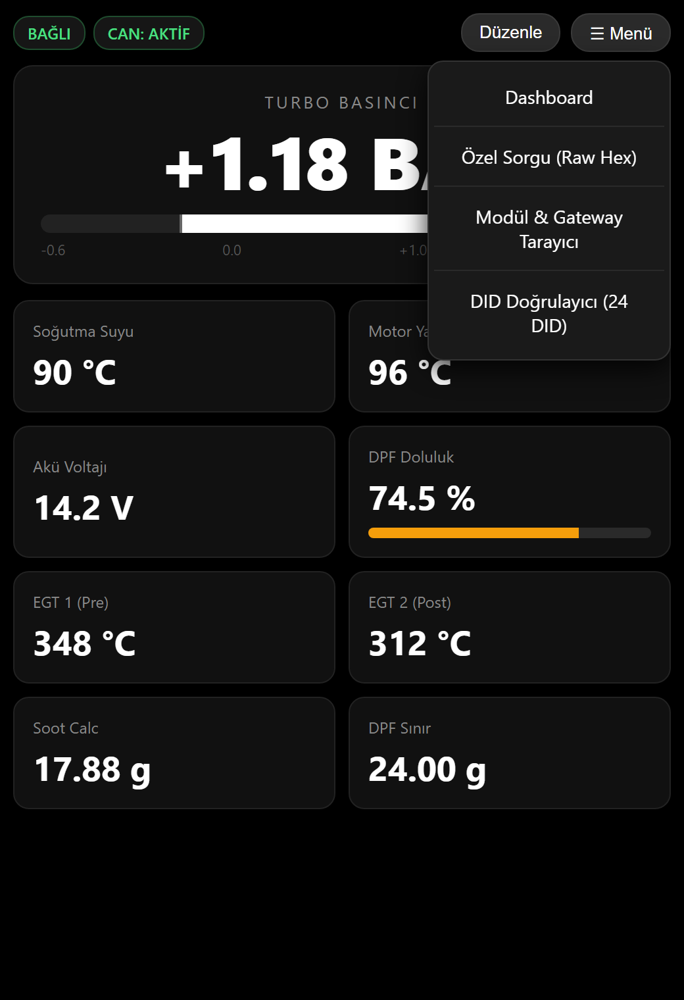
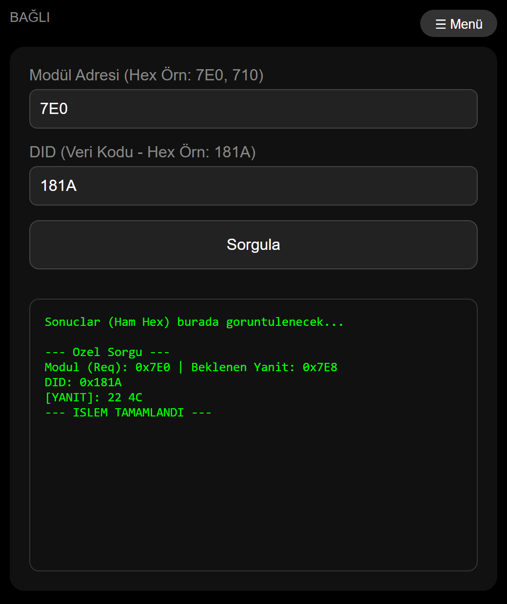
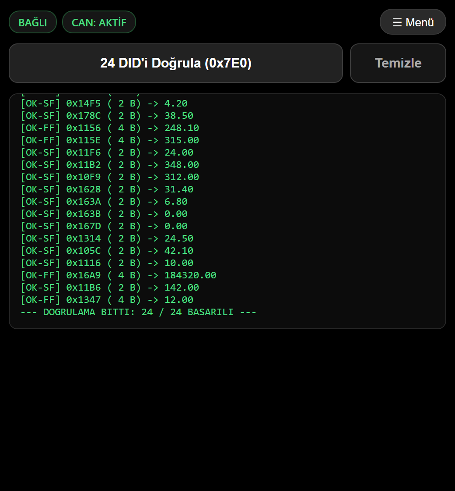

# Can-Octy

Skoda Octavia MY13 (VAG MQB, EA288 1.6 TDI CLHA) aracına MCP2515 ile CAN-Bus üzerinden bağlanıp canlı motor/DPF verilerini okumak ve modül/DID sorgulamak için yazdığım Arduino Nano ve Raspberry Pi Pico 2 W kodları.

## Arayüz Önizleme

`vag_pico_custom_query` içindeki web arayüzünün örnek EA288 1.6 TDI verileriyle görünümü:

| Dashboard | Menü | Ekranı Özelleştir |
| :---: | :---: | :---: |
|  |  |  |

| Özel Sorgu (Raw Hex) | Modül & Gateway Tarayıcı | DID Doğrulayıcı |
| :---: | :---: | :---: |
|  |  |  |

## Klasörler ve İçerikleri

En güncel ve en kapsamlı çalışma `vag_pico_custom_query` klasöründedir. Diğer klasörler önceki denemeleri ve Arduino Nano araçlarını içerir.

- **`vag_pico_custom_query/`** *(En güncel / kapsamlı)*: Raspberry Pi Pico 2 W için çift çekirdekli (Core 1 CAN-Bus / Core 0 Wi-Fi AP + WebSocket) sistem. Canlı 24 DID MFD ekranı, Gateway tarayıcı, DID doğrulayıcı, OTA güncelleme, 5 dakika CAN sessizliğinde uyku modu ve sonradan eklenen **Özel Sorgu (Raw Hex)** sekmesi burada yer alır.
- **`vag_pico_all_in_one/`**: `vag_pico_custom_query` öncesindeki sürüm. Özel ham sorgu yerine PIO-USB Host üzerinden takılan USB belleğe 300 ms aralıkla `log_xxx.csv` kaydı alma özelliğini içerir.
- **`vag_pico_latency_test/`**: Pico 2 W üzerinde CAN hattına bağlanmadan sahte (mock) veri üreterek tarayıcıdaki WebSocket ve turbo barı akıcılığını test etmek için yapılan deneme kodu.
- **`vag_mfd_display/`**: Pico'ya geçmeden önceki Arduino Nano + SSD1306 OLED sürümü (`v1.3`). 26 DID için gerçek zamanlı gösterge kodu.
- **`vag_module_scanner/`**: Arduino Nano + OLED üzerinde 44 modüllük VAG MQB tablosunu tarayıp araçtaki modülleri bulan araç (`v1.1`).
- **`vag_did_validator/`**: Arduino Nano + OLED üzerinde ECU, TCU, KOMBI ve GATEWAY modüllerindeki DID adreslerinin yanıt verip vermediğini test eden araç (`v6.1`).
- **`archive/`**: Önceki denemeler ve ara sürümler (30 adet eski sketch):
  - `archive/nano-early/`: İlk Arduino Nano MFD (`v1.0`–`v2.0`, `v3`), simülatör ve çoklu modül tarayıcı denemeleri.
  - `archive/nano-isotp/`: ISO-TP akış kontrolüne geçiş dönemi (`v5`, `v6` adres doğrulayıcı ve ilk gateway tarayıcı/MFD denemeleri).
  - `archive/pico-early/`: İlk Pico 2 W denemeleri (SD kart loglamalı ilk MFD arayüzü, ayrı web modül tarayıcı ve DID doğrulayıcı).

## Donanım Bağlantıları

### Raspberry Pi Pico 2 W + MCP2515 (8 MHz kristal, 500 kbps CAN)
- `MISO`: GP16
- `CS`: GP17
- `SCK`: GP18
- `MOSI`: GP19
- USB Host (`vag_pico_all_in_one` için): `D+` = GP14, `D-` = GP15

### Arduino Nano + MCP2515 + SSD1306 OLED (8 MHz kristal, 500 kbps CAN)
- CAN `CS`: D10, `INT`: D2
- OLED `CS`: D9, `DC`: D8, `RES`: D7

## Wi-Fi AP Kurulumu (Pico Sketch'leri)

Wi-Fi kullanıcı adı ve şifresi repoya açık yazılmaması için koddan ayrılmıştır. Pico kodlarından birini derlemeden önce ilgili klasördeki `secrets.h.example` dosyasını `secrets.h` adıyla kopyalayıp içindeki `AP_SSID` ve `AP_PASS` değerlerini düzenleyin (şifre WPA2 için en az 8 karakter olmalıdır). `secrets.h` dosyası `.gitignore` içindedir.

## Notlar

- `vag_pico_custom_query/` dışındaki eski klasörler arşiv ve referans amaçlı ilk halleriyle korunmuştur.
- `vag_pico_custom_query/` sürümünde ISO-TP/UDS akışı, VAG `+0x6A` / `+0x08` yanıt adresi kuralı, çift yönlü beyaz turbo barı, sıfır heap WebSocket yayını ve pasif `Listen-Only` uyku yönetimi modernize edilip `arduino-cli` (`rp2040:rp2040:rpipico2w`) ile doğrulanmıştır.
