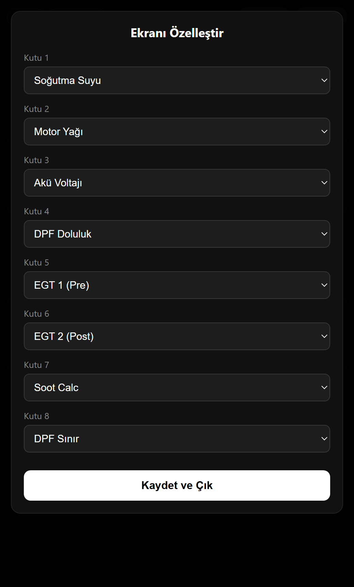
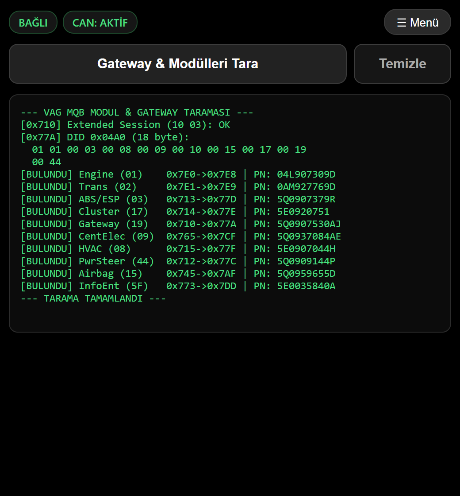

# Can-Octy

Kendi Skoda Octavia MY13 (MQB, 1.6 TDI EA288 CLHA) aracımda DPF doluluğunu, EGT sıcaklıklarını, turbo basıncını ve diğer motor verilerini canlı görebilmek için yazdığım CAN-Bus / UDS kodları.

Başta işi küçük tutup Arduino Nano, MCP2515 ve ufak bir OLED ekranla başladım. Hazır ODX dosyası ya da ücretli teşhis cihazı kullanmadan, motor beynindeki (`0x7E0`) 24 farklı DID adresini ve ölçekleme formüllerini araç üstünde tek tek deneyerek çıkardım. Bir noktadan sonra Nano'nun belleği ve küçük ekran yetmeyince Raspberry Pi Pico 2 W'ye geçtim. Şimdi cihaz OBD-II portuna takılı, kendi Wi-Fi ağını açıyor; telefondan tarayıcıyla canlı ekrana bakabiliyorum, kod değiştireceğim zaman da kabloyla uğraşmadan Wi-Fi üzerinden OTA ile atıyorum.

> **Canlı Demo (Tarayıcı Simülatörü):** [basararr.github.io/Can-Octy](https://basararr.github.io/Can-Octy/) — Arabaya bağlanmadan MFD ekranını, sürüş/DPF rejenerasyon senaryolarını, ham UDS özel sorguyu ve 24 DID hex çözücüyü tarayıcıda deneyebilirsin.

## Arayüz

`vag_pico_custom_query` içindeki web arayüzünün örnek 1.6 TDI verileriyle görünümü:

| Dashboard | Özel Sorgu (Raw Hex) |
| :---: | :---: |
|  |  |

Diğer ekranlar (Menü, Düzenle, Tarayıcı, Doğrulayıcı)

| Menü | Ekranı Özelleştir |
| :---: | :---: |
|  |  |

| Modül & Gateway Tarayıcı | DID Doğrulayıcı |
| :---: | :---: |
|  |  |

## Repoda Neler Var?

Aktif olarak kullandığım en güncel sürüm **`vag_pico_custom_query/`**. Diğer klasörleri projenin nasıl geliştiğini görmek ve eski araçlara dönüp bakabilmek için tutuyorum.

- **`vag_pico_custom_query/`** *(Ana proje)*: Pico 2 W için çift çekirdekli sistem. Canlı 24 DID ekranı, çift yönlü turbo barı, 8 kutuluk özelleştirilebilir MFD, Gateway/modül tarayıcı, 24 DID doğrulayıcı, ham UDS **Özel Sorgu** sekmesi, Wi-Fi OTA ve pasif uyku modu burada.
- **`vag_pico_all_in_one/`**: Bir önceki sürüm. Özel sorgu sekmesi yerine PIO-USB Host ile takılan flash belleğe 300 ms aralıkla `log_xxx.csv` yazıyordu.
- **`vag_pico_latency_test/`**: Araçta değilken sahte veri basıp telefondaki WebSocket ve turbo barı akıcılığını denemek için yazdığım test kodu.
- **`vag_mfd_display/`**: Pico'ya geçmeden önceki Arduino Nano + SSD1306 OLED göstergesi (`v1.3`).
- **`vag_module_scanner/`**: Nano + OLED üzerinde 44 modüllük VAG MQB tablosunu tarayan araç (`v1.1`).
- **`vag_did_validator/`**: Nano + OLED üzerinde ECU, TCU, KOMBI ve Gateway DID adreslerini yoklayan araç (`v6.1`).
- **`archive/`**: İlk denemeler ve ara sürümler (30 eski sketch):
  - `archive/nano-early/`: İlk Nano MFD (`v1.0`–`v3`), simülatör ve tarayıcı denemeleri.
  - `archive/nano-isotp/`: ISO-TP akış kontrolüne geçtiğim dönemdeki (`v5`, `v6`) doğrulayıcı ve tarayıcılar.
  - `archive/pico-early/`: İlk Pico 2 W denemeleri (SD kart loglamalı MFD ve ayrı web araçları).

## Donanım Bağlantıları

### Raspberry Pi Pico 2 W + MCP2515 (8 MHz kristal, 500 kbps)
- `MISO`: GP16
- `CS`: GP17
- `SCK`: GP18
- `MOSI`: GP19
- USB Host (sadece `vag_pico_all_in_one`): `D+` = GP14, `D-` = GP15

### Arduino Nano + MCP2515 + SSD1306 OLED (8 MHz kristal, 500 kbps)
- CAN `CS`: D10, `INT`: D2
- OLED `CS`: D9, `DC`: D8, `RES`: D7

## Kurulum (Wi-Fi ve OTA)

Wi-Fi adını ve şifresini repoda açık bırakmamak için `secrets.h` dosyasına ayırdım (`.gitignore` içinde). Derlemeden önce kullandığın Pico klasöründeki `secrets.h.example` dosyasını `secrets.h` olarak kopyalayıp kendi `AP_SSID` ve `AP_PASS` bilgilerini yazman yeterli (WPA2 için şifre en az 8 karakter olmalı).

`vag_pico_custom_query` Wi-Fi üzerinden `ArduinoOTA` ile güncellenebiliyor. Bunun çalışması için Arduino IDE'de flash bölümünü dosya sistemiyle ayırmak gerekiyor:
- **Board:** `Raspberry Pi Pico 2 W`
- **Flash Size:** `4MB (Sketch: 2MB, FS: 2MB)`

---

24 EA288 1.6 TDI (CLHA) DID Tablosu ve Formüller (0x7E0 -> 0x7E8)

Araç üstünde doğruladığım UDS `0x22` (ReadDataByIdentifier) adresleri:

| DID | Parametre | Boyut | Formül | Birim |
| :--- | :--- | :---: | :--- | :---: |
| `0xF405` | Soğutma Suyu | 1 B | `raw - 40` | °C |
| `0x11BE` | Motor Yağı | 2 B | `(raw / 10) - 273.1` | °C |
| `0x181A` | Turbo Basıncı (Relatif) | 2 B | `((raw * 0.25) - 1000) / 1000` | BAR |
| `0x105E` | Akü Voltajı | 2 B | `raw / 50` | V |
| `0x100C` | Yakıt Seviyesi | 2 B | `raw / 100` | L |
| `0x114F` | Soot Calc (Hesaplanan Kurum) | 2 B | `raw / 100` | g |
| `0x114E` | Soot Meas (Ölçülen Kurum) | 2 B (signed) | `int16(raw) / 100` | g |
| `0x14F5` | DPF Fark Basıncı (dP) | 2 B (signed) | `int16(raw) / 10` | hPa |
| `0x178C` | Oil Ash (Yağ Külü) | 2 B | `raw / 10` | g |
| `0x1156` | Son Regenden Mesafe | 4 B | `raw / 1000` | km |
| `0x115E` | Son Regenden Süre | 4 B | `raw / 60` | dk |
| `0x11F6` | DPF Doluluk Sınırı | 2 B | `raw / 100` | g |
| `0x11B2` | EGT 1 (DPF Öncesi) | 2 B | `(raw / 10) - 273.1` | °C |
| `0x10F9` | EGT 2 (DPF Sonrası) | 2 B | `(raw / 10) - 273.1` | °C |
| `0x1628` | Emme Havası (Intake Temp) | 2 B | `(raw / 10) - 273.1` | °C |
| `0x163A` | Ana Enjeksiyon | 2 B | `raw / 100` | mg |
| `0x163B` | Post Enjeksiyon 2 | 2 B | `raw / 100` | mg |
| `0x167D` | Post Enjeksiyon 3 | 2 B | `raw / 100` | mg |
| `0x1314` | LP-EGR | 2 B | `raw / 100` | % |
| `0x105C` | Şarj Yükü | 2 B | `raw / 81.92` | % |
| `0x1116` | Radyatör Fanı | 2 B | `raw / 100` | % |
| `0x16A9` | Odometer | 4 B | `raw` | km |
| `0x11B6` | Regen Sayısı | 2 B | `raw` | adet |
| `0x1347` | Regen Süresi | 4 B | `raw / 60` | dk |

*Arayüzdeki **DPF Doluluk (%)** değeri ayrıca `(Soot Calc / DPF Sınır) * 100` olarak hesaplanır.*

Teknik Notlar (Çift Çekirdek, ISO-TP/UDS, Uyku ve Besleme)

- **Çift çekirdek ayrımı:** Core 1 sadece MCP2515 SPI iletişimini ve UDS/ISO-TP zamanlamasını yürütür. Core 0 Wi-Fi AP, web sunucusu, WebSocket yayını ve `ArduinoOTA` tarafına bakar. Aradaki veri ve log aktarımı sabit boyutlu buffer'lar ve mutex ile yapılır, böylece uzun sürüşte heap parçalanması oluşmaz.
- **VAG MQB adres kuralı:** Özel Sorgu sekmesinde `0x7E0..0x7E7` için yanıt adresi otomatik `+0x08`, diğer modüller için `+0x6A` hesaplanır; farklı adresli modüller için manuel RX ID de girilebilir. Çok çerçeveli (multi-frame) yanıtlarda Flow Control (`STmin = 5 ms`) ve `NRC 0x78` (ResponsePending) beklemesi desteklenir.
- **Watchdog:** Core 1 düzenli heartbeat üretir; SPI tarafında kilitlenme olursa Core 0 watchdog'u beslemeyi bırakır ve RP2350 otomatik yeniden başlar.
- **Uyku ve OBD-II besleme notu:** Araç kapanıp CAN hattı sustuğunda Pico Wi-Fi'yi kapatır ve MCP2515'i pasif `Listen-Only` moduna alır — bu sayede hata veya ACK basıp aracın CAN hattını uyanık tutmaz. Kapı/kontak açılıp CAN trafiği başladığında cihaz kendini yeniden başlatıp Wi-Fi ve OTA'yı tekrar açar. Yine de OBD-II portunda sürekli 12V (`KL30`) olduğu için Pico uykuda bile az da olsa akım çekmeye devam eder; araç uzun süre yatacaksa kontak elektriği (`KL15`) ya da araya küçük bir anahtar eklemek daha sağlıklı olur.

